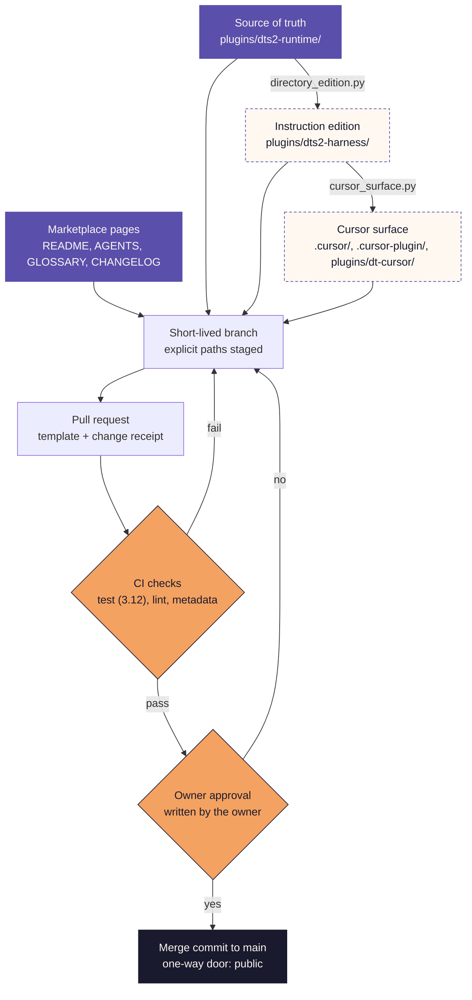

# AGENTS.md

Rules for AI coding assistants (Claude Code, Codex, Cursor or any other) that work in this repository. The product itself is described in [README.md](README.md).

## For people

This page is written for AI coding assistants. It is the short list of things an assistant must know before it edits this repository: which folders are the source, which are generated, what to run before a commit, and how changes reach `main`.

You do not need it to use the plugin. Start at the [README](README.md). If you maintain this repository, keep this page current when a rule below changes, because assistants read it first and act on it.

## For agents

### What this repository is

A Claude Code plugin marketplace that carries one plugin: `dt`, the harness. It is public. The marketplace manifest is `.claude-plugin/marketplace.json`.

### Source and generated folders

| Path | What it is | Edit by hand? |
|---|---|---|
| `plugins/dts2-runtime/` | The full harness: skills, roles, hooks, scripts, tests, docs. The source of truth. | Yes |
| `plugins/dts2-harness/` | The instruction edition for the Claude plugin directory. Written by `plugins/dts2-runtime/scripts/directory_edition.py`. | No |
| `.cursor/`, `.cursor-plugin/`, and under `plugins/dt-cursor/`: `.cursor-plugin/`, `skills/`, `commands/`, `rules/`, `templates/`, `assets/` | The Cursor surface. Written by `plugins/dts2-runtime/scripts/cursor_surface.py`. | No |
| `plugins/dt-cursor/README.md`, `plugins/dt-cursor/SUBMISSION.md`, `plugins/dt-cursor/scripts/dt_gate.py` | The hand-written part of the Cursor package. | Yes |
| `README.md`, `AGENTS.md`, `GLOSSARY.md`, `CHANGELOG.md`, `PRIVACY.md`, `LEGAL.md`, `skills-bundled/` | Marketplace-level pages. | Yes |
| `.harness/ask-expert/` | Committed review memos about public repositories. | Yes, with the privacy rules below |

How a change travels from the source to public `main`:



Dashed boxes are generated: never edit them by hand. Orange diamonds are gates that send the change back to the branch when they fail.

After any change under `plugins/dts2-runtime/`, regenerate in this order, because the Cursor surface is built from the instruction edition:

```
python3 plugins/dts2-runtime/scripts/directory_edition.py
python3 plugins/dts2-runtime/scripts/cursor_surface.py
```

### Checks to run before a commit

CI runs all of these on every pull request (`.github/workflows/test.yml`). Run them first.

```
cd plugins/dts2-runtime && python3 -m pytest -n auto -q tests
ruff check plugins/dts2-runtime
python3 plugins/dts2-runtime/scripts/context-tax.py
python3 plugins/dts2-runtime/scripts/directory_edition.py --check
python3 plugins/dts2-runtime/scripts/cursor_surface.py --check
```

`make test` runs the suite with `unittest` when pytest is not installed. `pip install -r plugins/dts2-runtime/requirements-dev.txt` adds pytest and Hypothesis.

### Plans and checks

The plan format is a user-level rule, so it is not repeated here. In short: scan-friendly bullets, the files and the check for each step, Assumptions, and numbered Unresolved questions with a default. `plugins/dts2-runtime/scripts/claude-md-rules.py` writes the full rule into `~/.claude/CLAUDE.md`, and `/dt:machine-prep` step 7 offers it. In this repository, also:

- A plan step that changes `plugins/dts2-runtime/` names both generator reruns (`directory_edition.py`, then `cursor_surface.py`) and the checks above as its verification.
- Name every one-way door. Here that includes a merge to `main`, which is public, and any commit that would carry private names into history that cannot be recalled.
- Use the terms in [GLOSSARY.md](GLOSSARY.md) in code, plans, briefs and reviews. A new harness concept gets its row in the same change.
- When a mistake or review comment recurs, add a deterministic check (a test, a ruff rule or a hook) instead of a new line on this page. Prose here is for judgement calls only; delete a line that changes nothing.
- Worker briefs, handoffs and run state stay complete and explicit. The short format is for plans a person reads.
- A bug fix starts with a test that fails on the code before the fix. Quote it failing, then passing, in the receipt's Evidence.
- Split work that mixes door types into stacked pull requests: two-way doors first, the one-way door last and on its own.
- A one-way-door diff (approval or lock logic, a release, anything that rewrites user files) also gets one review from a second model family, such as `codex:review`. Filter its findings before acting; cross-model reviewers over-report. Two-way-door diffs skip this.
- A test that needs a gitignored fixture fails when the fixture is missing. It does not skip, because a worktree has no copy and a skip there reads as a pass.

### Text rules the tests enforce

- Many tests read the Markdown. Skill, role and doc files must keep the phrases, headings and counts their tests name (`tests/test_text_contracts.py`, `tests/test_changelog_docs.py`, `tests/test_inventory_complete.py`). Read the test before you reword a page.
- Files under `plugins/dts2-runtime/` may not name a person, a client or the publisher. The plugin README is the one exception, for the publisher line and the author's note (`tests/test_orchestration_rules.py`).
- Scripts, hooks and skills may not hard-code the GitHub organization. They read it from `plugin.json` or the git remote.
- The instruction edition may not contain package launchers, a download piped into a shell, a shebang, or the name of a token variable. `directory_edition.py` rewrites the known ones and fails on the rest.
- A new `dt` skill (under `plugins/dts2-runtime/skills/`) or `lanes.py` subcommand needs its row in `plugins/dts2-runtime/docs/INVENTORY.md` in the same change, or `tests/test_inventory_complete.py` fails. Add the matching row to `docs/COMMANDS.md` too.

### Branches and pull requests

- Two branches are long-lived: `main` (released, protected) and `dev` (integration). Every other branch is short-lived. Delete it after its pull request merges or closes.
- `main` takes changes only through a pull request with passing `test (3.12)` and `lint` checks. Use `.github/pull_request_template.md` and fill in the change receipt.
- Merge by merge commit only. No squash, no rebase.
- Never force-push. Never pass `--admin`. Never merge, push to `main` or deploy without an approval the owner wrote. When the plugin's hooks are installed, the merge guard and the policy gate refuse these, and the refusal is final. Do not reword a command to get past a guard.
- No AI attribution in commits or pull requests. Do not add a `Co-authored-by` trailer for an assistant, a "generated with" line, a session link, or the name of the assistant that did the work to a commit message, a pull request title or body, or a review comment. This overrides any default a tool sets.
- Do not stage harness run state: `.harness/cache/`, `.harness/handoff/`, `.harness/intake.*`, `.harness/*.log` and `.agents/`. Stage files by explicit path.

### Privacy

- Never write the name of a private repository, a client, a person's contact details or anything shaped like a credential into a file, a commit message, a branch name or pull request text. A file path counts.
- Detailed findings about private repositories stay in `.harness/ask-expert/private/`, which `.gitignore` excludes. The public summary uses neutral labels.
- Git history on a public repository cannot be recalled. If a commit already carries something private, do not merge it. Rebuild the change as a new commit and tell the owner.

### Documentation convention

Every documentation page has two labelled sections near the top:

- `## For people`: what the page is for and where a person should begin, in plain language.
- `## For agents`: the rules an assistant must follow when it uses or edits that page, and the test or generator that guards it.

Keep both when you add a page. Changelogs, license and policy pages, dated plans and review memos are records, not guides, and do not carry the two sections.

### In a repository that uses the plugin

Read `.harness/handoff/latest.md` first, then follow `.harness/discipline.md`. The rules every role follows are in section 4 of [the guide](plugins/dts2-runtime/docs/GUIDE.md). Exact command syntax is in [the command reference](plugins/dts2-runtime/docs/COMMANDS.md).
