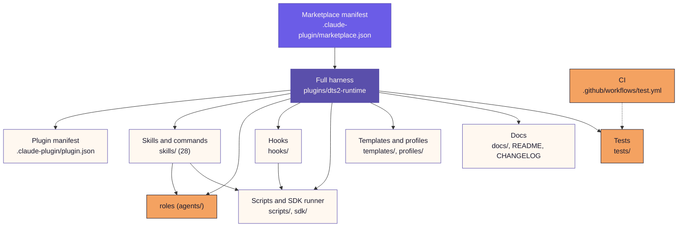

# dt: a Claude Code harness for planned, reviewed pull requests

[](https://dobeu.net)

A **Dobeu Tech Solutions LLC** product. New York, NY · [dobeu.net](https://dobeu.net)


`dt` turns one task into a planned, built, reviewed and verified pull request, with you approving at the points that matter. Commands stay `/dt:<command>`. The listing title is “DT: Init to Ship Auto Agent Orchestrator.”

## From Jeremy

This started as a passion project and became the orchestrator I use to take work from init to ship. I was not planning to release it. It paid off in my own productivity, so I am putting it out. I hope it helps. Edits are welcome.

I tested it on T3. The roster also marks these as verified in my use: Claude Code, OpenAI Codex, and OpenCode. Grok review and builder commands were exercised on 2026-10-22, and those model ids are still unverified. Parallel runs are set up for Linux, macOS, WSL, and Docker.

This repository is the Claude Code plugin marketplace for that product. It carries one plugin, `dt`. It is for developers and small teams who already use Claude Code and want a repeatable way to run larger changes.

You approve an end state once. Separate roles plan, build, review and verify the work, and every run ends with a receipt and a pull request. Single-file fixes do not need it.

## Quick start

Prerequisites:

- Claude Code with plugin support
- `git`
- the `gh` CLI, for anything that opens pull requests
- Python 3.10 or newer (`python3`), standard library only

Install, inside Claude Code:

```
/plugin marketplace add Dobeu-tech-eco/dts2-marketplace
/plugin install dt@dts2
```

Restart Claude Code, then run `/dt:onboard`. It explains the roles and commands, and writes nothing until you pick.

Update later:

```
/plugin marketplace update dts2
/reload-plugins
```

## How it works

- **End state first.** You approve what "done" means once. `/dt:check-in` shows `N of M complete` against it at any time.
- **Separate roles.** A lead plans, builders build on disjoint files, reviewers review and a verifier checks the result. Builders never review their own work.
- **Checkpoints.** The run pauses for your `approve`, `edit` or `stop` at the plan and before shipping. Nothing merges or deploys unless you approved it.
- **Parallel lanes.** `/dt:dpp` gives each lane its own git worktree and merges one lane at a time.
- **Handoff file.** Any role can resume where the last one stopped, so a closed session does not lose context.
- **Cost discipline.** Frontier models advise and sign off. Builders use the cheapest capable model.

The plugin has 28 skills (the slash commands) and 8 roles: lead, builder, fixer, reviewer, verifier, scout, auditor and incident-reviewer.

## Repository layout



## What's new in 5.1.1

- Ready for the Claude plugin directory: hook scripts now pass its checks.
- Rewritten READMEs with an "All commands" table, plus a listing icon.
- Composio: connections map correctly, including a `composio` CLI installed inside WSL.
- Composio: if you say yes during onboarding, always-use is now on by default. You can turn it off.

### What's new in 3.0.0

The first release of the end-state interview, Plan and Ship checkpoints, roster and deployment verification. Every later release is in the [plugin changelog](plugins/dts2-runtime/CHANGELOG.md).

The Claude plugin directory tracks `plugins/dts2-harness`, an instruction edition generated from the full harness. It has the skills and roles, and it does not include hooks or scripts. Regenerate it with `python3 plugins/dts2-runtime/scripts/directory_edition.py`.

## Cursor

Claude Code installs `dt@dts2` and exposes each skill as `/dt:<skill>`. Cursor does not use that colon form. Current Cursor docs name a skill `/skill-name` and take a command's slash name from the filename stem, without a plugin prefix ([plugins reference](https://cursor.com/docs/reference/plugins), [skills](https://cursor.com/docs/skills)). This repo adds a separate package, `plugins/dt-cursor`, for that surface:

| Claude Code | Cursor |
|---|---|
| `/dt:check-in` | `/dt-check-in` |
| `/dt:<skill>` | `/dt-<skill>` |
| plugin skill list | `/dt` (explicit invoke only) |

`plugins/dt-cursor/skills/dt-<name>/` holds 27 procedures. `scripts/dt_gate.py` scaffolds only after an end-state approval digest, and it stops a run until the plan and ship digests match. Merges, fleet broadcast, hook install, the headless SDK, and paid calls exit `CURSOR_UNSUPPORTED` and are not executed. Skill folders are `dt-<name>` so they do not take Cursor's `/sdk`, `/autopilot`, or `/run`.

Files in the repo are not the same as a loaded command. Cursor loads project skills from `.cursor/skills/` and project commands from `.cursor/commands/` for a new session in this repo. A session that already started keeps the catalog it started with. Other repos, self-hosted workers, and automations do not see those files. Account-wide use needs the plugin installed from this commit. Install and the submission checklist are in [plugins/dt-cursor/README.md](plugins/dt-cursor/README.md) and [plugins/dt-cursor/SUBMISSION.md](plugins/dt-cursor/SUBMISSION.md).

Regenerate the Cursor files with `python3 plugins/dts2-runtime/scripts/cursor_surface.py`. `--check` fails when they drift.

## Where to go next

| Read | For |
|---|---|
| [Plugin README](plugins/dts2-runtime/README.md) | The manual: wiring, config files, all commands, troubleshooting |
| [Cursor package](plugins/dt-cursor/README.md) | Cursor install, `/dt-*` names, and what a load proves |
| [Guide](plugins/dts2-runtime/docs/GUIDE.md) | Which command to use when, and how to talk to the harness |
| [Command reference](plugins/dts2-runtime/docs/COMMANDS.md) | Exact invocation of every command |
| [Plugin changelog](plugins/dts2-runtime/CHANGELOG.md) | Full release history |
| [Marketplace changelog](CHANGELOG.md) | Marketplace-level changes |
| [LICENSE](LICENSE) | MIT. Copyright Dobeu Tech Solutions LLC |
| [Privacy](PRIVACY.md) | Company privacy policy, and what this product does with data |
| [Legal](LEGAL.md) | Terms, cookies, and opt-out pages on dobeu.net |

Day to day: run `/dt:setup` once per repo to agree an end state. Then `/dt:run <task>` takes one task from plan to pull request with checkpoints, and `/dt:check-in` shows progress. Use `/dt:ship` when the work is already on a branch and you want a checked pull request.

For bounded role-instruction research, `/dt:loop <experiment.json>` compares one editable file on a frozen past-month receipt batch under fixed token and wall-clock caps. One metric decides keep/revert; every attempt is ledger-logged. The [experiment spec example](plugins/dts2-runtime/templates/loop-experiment.example.json) is inert. Improvements remain proposals for `/dt:ship` and existing merge gates; this update runs no production experiment.

## Known limits

- Login state for gemini, grok, muse and opencode is self-reported by you. The harness cannot verify it.
- Impeccable and marketing-skills are external plugins. The harness uses them when installed and does not bundle them.
- Parallel runs need Linux, macOS, WSL or Docker.
- If your WSL `claude` command wraps the Windows `claude.exe`, install once from Windows. Install inside WSL only when you run the native Linux CLI there.

## Updating and uninstalling

Update with the two commands in [Quick start](#quick-start). To remove the plugin:

```
/plugin uninstall dt@dts2
/plugin marketplace remove dts2
```

Your repos' `.harness/` folders, `.claude/dts2-harness.local.md` and `~/.dts2/` stay in place until you delete them.

Coming from an older name? Uninstall the old plugin first (`/plugin uninstall dts2@dts2`, or `dts2-harness@dts2` before 4.0), then install `dt@dts2`. Settings and `.harness/` state are unchanged.

## Acknowledgements

dt builds on patterns from these projects. We learned from them and wrote our own implementation. No code was copied. The full credit register, with each publisher's repository and license, is in [skills-bundled](skills-bundled/README.md).

- [oh-my-claudecode](https://github.com/Yeachan-Heo/oh-my-claudecode) (MIT, Yeachan Heo): the deep-interview pattern behind the end-state interview.
- [Impeccable](https://github.com/pbakaus/impeccable) (Apache-2.0, Paul Bakaus): the critique and polish pattern behind the finish pass.
- [marketingskills](https://github.com/coreyhaines31/marketingskills) (MIT, Corey Haines): the go-to-market sequence behind `gtm`.
- [mattpocock/skills](https://github.com/mattpocock/skills) (MIT, Matt Pocock): companion skills installed into the project, not copied here.
- [warpdotdev/common-skills](https://github.com/warpdotdev/common-skills) (MIT, Denver Technologies, Inc.): `resolve-merge-conflicts`.
- [obra/superpowers](https://github.com/obra/superpowers) (MIT, Jesse Vincent): the `test-driven-development` skill recommended by slug.
- [wshobson/agents](https://github.com/wshobson/agents) (MIT, Seth Hobson): the database skills recommended by slug.
- [anthropics/skills](https://github.com/anthropics/skills/tree/main/skills/frontend-design) (Apache-2.0 on `frontend-design`): the frontend skill recommended by slug.

## More from Dobeu Tech Solutions

- [StatMiner](https://github.com/Dobeu-tech-eco/statminer) ([live](https://statminer.vercel.app)): data-driven answers to complex questions.
- [DOT Copilot](https://github.com/Dobeu-tech-eco/DOT-Copilot) ([live](https://dot-copilot.vercel.app))
- [Super RAG MCP](https://github.com/Dobeu-tech-eco/super-rag-mcp): self-hosted RAG over local and cloud sources, exposed as an MCP server.
- [Claude Harness (minimal)](https://github.com/Dobeu-tech-eco/plugin-claudeharness): a four-role lead, builder, reviewer, verifier pipeline for Claude Code.
- [Dobeu v0 Skills Pack](https://github.com/Dobeu-tech-eco/dobeu-v0-skills-pack): a skills pack for v0.

## License and support

A Dobeu Tech Solutions LLC product. MIT License. Copyright Dobeu Tech Solutions LLC. See [LICENSE](LICENSE), [PRIVACY.md](PRIVACY.md), and [LEGAL.md](LEGAL.md). The live company policies are at [dobeu.net/privacy](https://dobeu.net/privacy) and [dobeu.net/terms](https://dobeu.net/terms).

Fork it, add to it, take things out, and use it in whatever you are building, including paid work. Keep the copyright notice so the original stays credited to Dobeu Tech Solutions LLC.

Bug reports and questions: open an issue at [github.com/Dobeu-tech-eco/dts2-marketplace/issues](https://github.com/Dobeu-tech-eco/dts2-marketplace/issues).
