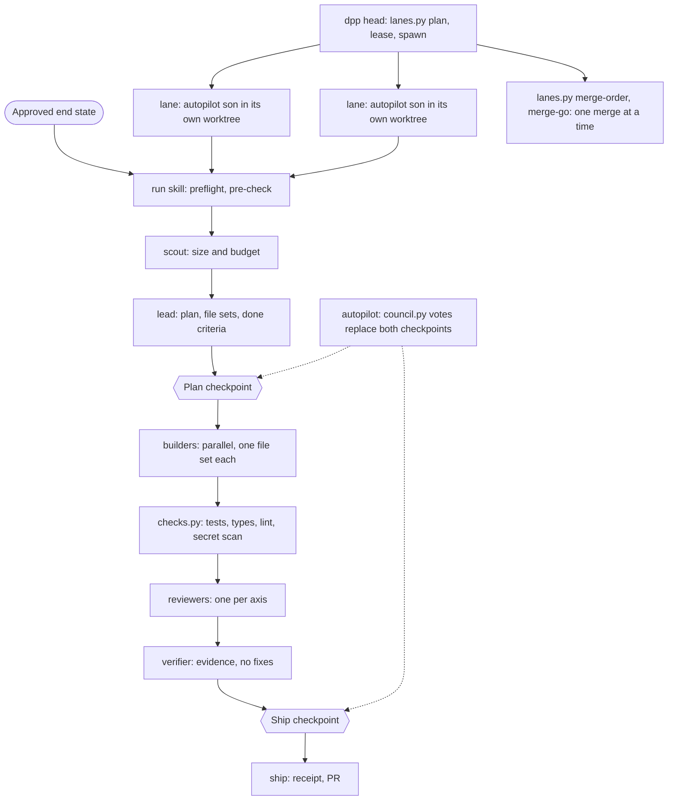

# dts2-harness architecture

One page. It describes what exists in this plugin: the skills that drive a run, the agents they dispatch, the scripts that hold the rules, the state under `.harness/`, and the hooks. Rules live in `templates/discipline.md` and the skills; this page only maps them.

## Flow

- **run** is the pipeline: preflight, scout (tier and builder count), lead (plan), builders, review and verify, ship. A human approves at the Plan and Ship checkpoints.
- **autopilot** replaces those two human checkpoints with a vote. The ballots are tallied by `scripts/council.py`; after three unsettled rounds the council sits, a dissenter must write a brief, and the head of the council answers each one.
- **dpp** (and **fullauto**, which loops it) runs several autopilot lanes at once. Each lane is a headless son in its own worktree and branch (`dts2/<stamp>/lane-<id>`). `scripts/lanes.py` is the only writer of lane state: file-set overlap check, leases with epochs, spawn under spend and model-call caps, heartbeats, send-backs, merge order.
- **ship** pushes the branch and opens the PR with the change receipt.

## Agents

| Agent | Role |
| --- | --- |
| scout | read-only sizing, harness and marketing-surface detection, evidence collection |
| lead | read-only planner; slices the end state into builder sections with exclusive file ownership |
| builder | implements one builder section inside its file set |
| reviewer | read-only review on one or all axes; severity-rated findings and a verdict |
| verifier | read-only; runs the configured commands and reports evidence |
| auditor | read-only inventory of installed agent tooling (used by machine-prep) |

## State under `.harness/`

| Path | Written by | Holds |
| --- | --- | --- |
| `config.yaml`, `review-checklist.md`, `discipline.md`, `keep.yaml` | setup | commands, roster, review checklist, rules copy, keep list |
| `end-state.md`, `state.md`, `lessons.md`, `action-items.md` | setup, run, learn, action-items | approved end state, progress, lessons, open items |
| `handoff/latest.md`, `handoff/<agent>/<n>.md` | `handoff-write.py`, stop hook | resume point for any agent |
| `runs/<stamp>/plan.md`, `receipt.md`, `task-ledger.md` | run, ship, `task-ledger.py` | plan, change receipt, per-task record |
| `runs/<stamp>/ledger.jsonl` | `checks.py`, `council.py` | check results with HEAD sha, env, ballots |
| `runs/<stamp>/run.json`, `budget.json`, `model-ledger.jsonl` | `lanes.py` | pinned CLI version, spend counter, model-call ledger |
| `runs/<stamp>/merge-order.json`, `merge-go.md` | `lanes.py` | serialised merge state |
| `runs/<stamp>/<lane>/lease.json`, `status.json`, `brief.md`, `send-back-<n>.md`, `questions/<n>.md` | `lanes.py`, the son | lane lease and epoch, phase and heartbeat, brief, send-backs, son questions |
| `autopilot/latest.md`, `council.md` | autopilot, `council.py` | last autopilot run, council decisions |
| `metrics.jsonl` | `metrics.py`, `run_metrics.py` | one line per run for the trend report |
| `wt/<n>/` | run | scratch directories for builders when the folder is not a git repo |

State writes from the scripts go through `scripts/state_io.py` (`atomic_write`, `append_text`).

## Hooks

| Event | Script | What it does |
| --- | --- | --- |
| SessionStart | `hooks/session-lessons.sh` | puts recent lessons, open state items and open action items into context; after a compact (`source` is `compact`) prints only a short resume pointer |
| PreCompact (auto, manual) | `hooks/pre-compact.sh` | runs `handoff-write.py` so the post-compact session resumes from the handoff |
| Stop | `hooks/stop-checks.sh` | refreshes `handoff/latest.md`, runs quick typecheck and lint on changed files; warns, never blocks |
| PreToolUse (Bash) | `hooks/merge-guard.sh` | refuses a force-push, and a merge or push to a protected branch unless a lane's `merge-go.md` allows it |
| PostToolUse (Bash) | `hooks/pr-receipt.sh` | on `gh pr create` or `edit`, makes sure the PR body carries the change receipt |
| PostToolUse (all tools) | `hooks/context-guard.sh` | stops a run on a context spike before the plan checkpoint |

Hooks read settings from `.claude/dts2-harness.local.md` through `hooks/lib-settings.sh`.

## Scripts worth knowing

`checks.py` (deterministic gate), `council.py` (dossier, tally, blind ballots, seats), `lanes.py` (thin CLI over the `scripts/lanes/` package: `conflicts`, `leases`, `gitrefs`, `planner`, `runstate`, `supervisor`, `merge`, shared `common`; `integration` routes lockfiles, migrations, route tables, barrels and `lanes.shared_files` to a final integration lane and caps a PR at 5 tasks; `mergeplan` is the merge-queue or serial rebase-test-merge plan with the `git merge-tree --write-tree` probe), `seat_swap.py` (swaps a timed-out council seat for the next bench provider and notes identical findings in the run ledger), `walkthrough_fallback.py` (optional Playwright post-merge walkthrough: sandbox only, host allowlist, no `file://`, screenshots in the report), `roster.py` and `delegate.py` (which agent and model for which seat), `prod-scaffold.py` (CI and ops files for a target app), `doctor.py` (preflight table, `make doctor`), `run_report.py` (one run as a markdown table for check-ins), `run_metrics.py` (lanes, tokens and wall-clock in `metrics.jsonl`; plan-time and post-run warnings).

`skills/autopilot/` and `skills/setup/` are short routers (`SKILL.md`) that point to phase files read on demand (`phase-*.md`, `son-mode.md`); the text is the same as before, moved, a son reads its brief and `son-mode.md` first, then phase files on demand.

`briefs.py` (briefs and the cached prefix; `son-brief` fills `templates/son-brief.md`, the ~4 KB brief a son reads as `brief.md`; `lead-brief` turns the task, roster, probe and check ledger into one page for the lead; `prefix` is the fixed-order cached prefix of discipline, roster and probe that `son_launch.launch_flags` hands every son with `--append-system-prompt`; `dry-run` prints the exact son command, env names and byte counts without starting a session), `lessons.py` (lesson parsing, `{paths: ...}` glob matching, `promoted_at`, `regressed` and stale pruning), `scope-check.py` (session scope, plus `--lessons` for the matching lessons).
